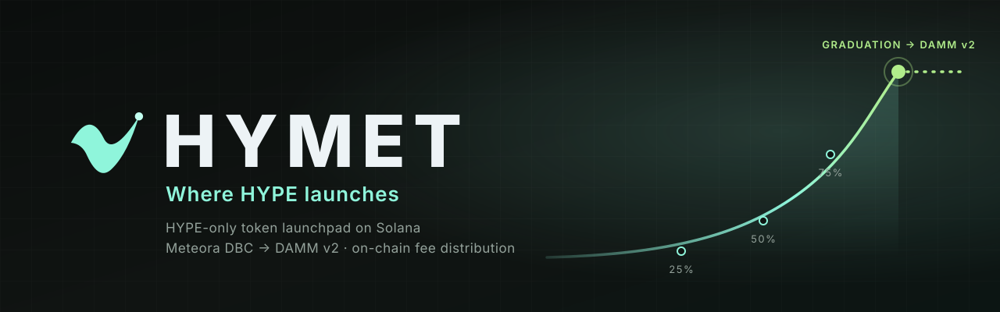
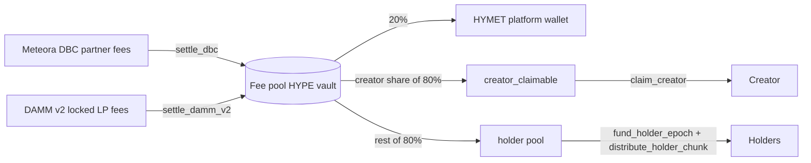

<p align="center">
  
</p>

<h1 align="center">HYMET Distributor</h1>

<p align="center">
  The on-chain fee distributor for <a href="https://github.com/Hymetdotfun/hymet">HYMET</a>, the HYPE-only token
  launchpad on Solana.<br>
  It collects a launch's Meteora trading fees in HYPE and splits them: <b>20% HYMET</b>, the rest between the creator
  and the token's holders.
</p>

<p align="center">
  
  
  
  
</p>

---

| | |
|---|---|
| **Program ID** | [`9X9fnj4Uh9WC9nmxCahTVsixHZ6VGxNpMesuGhK239Px`](https://solscan.io/account/9X9fnj4Uh9WC9nmxCahTVsixHZ6VGxNpMesuGhK239Px) |
| **Deployed binary** | 509,112 bytes, SHA-256 `fda10de4da728442da4a42a63bb1f5d8df614e49f8421c656ee2ca67f3be3e7b` |
| **Upgrade authority** | `9G9v3Ax4K2prmVQfDzp2HY6YYZ5UFmCo24761pgEmMo7` |
| **Config** | `5QMrhkg36hnJVBubARNLrL8vPaCb9koRYLeffVc8GNHG` |
| **Source of truth** | This program also lives in [`Hymetdotfun/hymet`](https://github.com/Hymetdotfun/hymet) under `programs/`; this repository mirrors it with its history for auditing and build verification |

## How it works



- **One fee pool per token**, a program-derived address that is the DBC fee claimer and owns the permanently locked
  DAMM v2 LP position. It can only claim Meteora fees and pay them out by these rules: there is no withdrawal
  instruction and no way to remove liquidity.
- **Holder payouts are pushed**, not claimed. The keeper commits a Merkle root of up to 6-holder chunks; anyone can
  submit a chunk, each chunk pays once, only to the holder's canonical HYPE account, never beyond the funded amount.
- **Canonical pool only.** After graduation only the DAMM v2 pool that Meteora's migration creates can be registered.

- **Keeper rules are off-chain.** The holder snapshot, payout minimums (0.01 HYPE, or 0.05 HYPE when the keeper creates
  the holder's HYPE account), carry-over and the 15-minute interval are set by the
  [keeper](https://github.com/Hymetdotfun/hymet/blob/main/docs/KEEPER.md), not by this program.

[docs/DISTRIBUTOR.md](docs/DISTRIBUTOR.md) documents every account, instruction and check, and what has been verified
on Mainnet.

## Verify

```bash
# The deployed program
solana program dump 9X9fnj4Uh9WC9nmxCahTVsixHZ6VGxNpMesuGhK239Px deployed.so -u mainnet-beta && sha256sum deployed.so

# This source, with Solana CLI 2.2.1
cargo build-sbf --manifest-path programs/hymet-rewards-distributor/Cargo.toml
sha256sum target/deploy/hymet_rewards_distributor.so

# Unit tests
cargo test --manifest-path programs/hymet-rewards-distributor/Cargo.toml
```

Both hashes must equal `fda10de4…3e7b`. Details: [docs/VERIFY-BUILD.md](docs/VERIFY-BUILD.md).

## Layout

```text
programs/hymet-rewards-distributor/   Program source (src/lib.rs) and crate manifest
Cargo.toml, Cargo.lock                Workspace and locked dependencies used for the deployed build
Anchor.toml, rust-toolchain.toml      Toolchain pins
docs/                                 Program reference and build verification
```

## Security

Internal security review and reproducible build; **no external audit yet**. Report vulnerabilities privately; see
[SECURITY.md](SECURITY.md).

## License

[Apache License 2.0](LICENSE). See [NOTICE](NOTICE).
